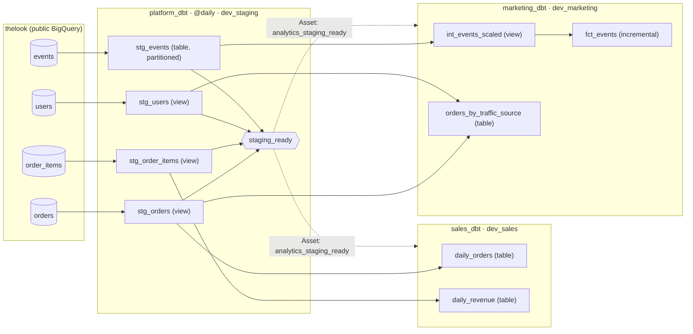

# DAGs and tables

Each team's DAG builds its own BigQuery dataset. `platform_dbt` builds staging, then updates the
`analytics_staging_ready` asset, which starts the team DAGs. Solid arrows are dbt `ref()`s.

